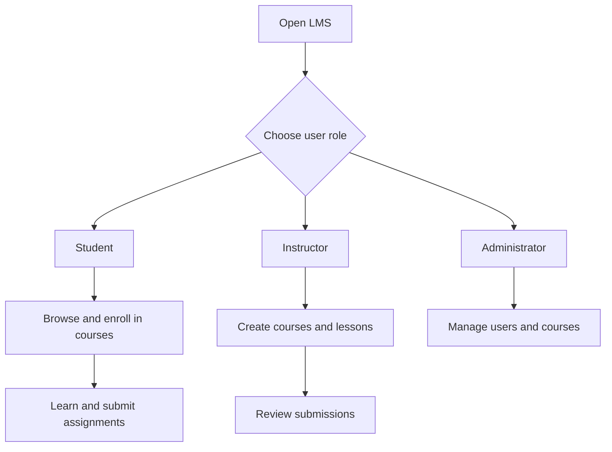

<div align="center">

# 🎓 Learning Management System (LMS)

### A foundation for a modern, organized digital learning platform

[](https://github.com/AdityaGit8009/lms)
[](https://github.com/AdityaGit8009/lms)
[](https://github.com/AdityaGit8009/lms/issues)

**[Repository](https://github.com/AdityaGit8009/lms)** · **[Report an Issue](https://github.com/AdityaGit8009/lms/issues)** · **[Developer](https://github.com/AdityaGit8009)**

</div>

---

## 📖 Overview

**LMS (Learning Management System)** is a project repository intended for building a centralized platform to manage digital learning activities. The goal is to support structured course delivery, user management, and learning progress in a single application.

> **Current repository status:** At the time this README was prepared (10 November 2026), the public GitHub repository contained no source files. The capabilities and architecture below describe a **proposed roadmap**, not verified implemented functionality. Update this document as code is published.

## 🎯 Project Goals

- Organize courses and educational resources in one place.
- Provide clear experiences for learners, instructors, and administrators.
- Simplify enrollment, assignments, and evaluation workflows.
- Offer visibility into learning progress and course completion.
- Build a maintainable, secure foundation that can expand over time.

## ✨ Planned Features

| Module | Proposed Capabilities | Status |
| --- | --- | --- |
| 🔐 Authentication | Registration, login, logout, password recovery | 📌 Planned |
| 👥 Role Management | Student, instructor, and administrator access | 📌 Planned |
| 📚 Course Management | Course creation, updates, listing, and organization | 📌 Planned |
| 🧩 Lessons & Resources | Learning materials, lessons, attachments | 📌 Planned |
| 📝 Assignments | Publishing, submissions, and grading | 📌 Planned |
| 📊 Progress Tracking | Course progress and completion insights | 📌 Planned |
| 📣 Notifications | Deadline and activity notifications | 📌 Planned |
| 📈 Admin Dashboard | User and course oversight | 📌 Planned |

These are product ideas, **not claims about existing code**.

## 🧭 Proposed User Workflow



## 🛠️ Technology Stack

**To be confirmed when source code is uploaded.** The repository currently does not provide enough information to accurately identify the application framework, database, or deployment stack.

| Layer | Technology |
| --- | --- |
| Frontend | To be documented |
| Backend | To be documented |
| Database | To be documented |
| Authentication | To be documented |
| Deployment | To be documented |

## 🚀 Getting Started

The project currently has no published application code or verified run instructions. You can clone the repository to begin development:

```bash
git clone https://github.com/AdityaGit8009/lms.git
cd lms
```

> Installation dependencies, environment variables, database setup, migrations, and start commands will be added after the project files are published.

## 📁 Project Structure

No application directory structure has been published yet. Add an accurate tree here after the first source-code commit.

## 🗺️ Development Roadmap

- [ ] Publish initial source code and dependency manifest
- [ ] Document local development setup
- [ ] Implement authentication and role authorization
- [ ] Implement course and lesson management
- [ ] Add enrollment and assignment workflows
- [ ] Add tests and validation
- [ ] Improve dashboards, accessibility, and responsiveness
- [ ] Document deployment and production configuration

## 🔒 Security Considerations

Before any production deployment:

- Store secrets and credentials in environment variables, not source control.
- Validate user input and uploaded files.
- Enforce server-side permissions for each role.
- Hash passwords using a trusted authentication framework.
- Configure secure sessions, CSRF protection, and HTTPS.
- Add tests for authentication and authorization boundaries.

## 🤝 Contributing

Contributions, suggestions, and bug reports are welcome. Please use the [Issues](https://github.com/AdityaGit8009/lms/issues) page to propose changes. When application code is available, fork the repository, create a feature branch, and open a pull request with a clear explanation of your changes.

## 👨‍💻 Developer

**Aditya Pratap Vishwakarma**

- **GitHub:** [@AdityaGit8009](https://github.com/AdityaGit8009)
- **LinkedIn:** [vish-aditya](https://www.linkedin.com/in/vish-aditya/)
- **Email:** [adityapratap7391@gmail.com](mailto:adityapratap7391@gmail.com)

## 📄 License

No license is specified yet. Until a license file is added, standard copyright rules apply. If you intend to make the code openly reusable, add a `LICENSE` file and update this section accordingly.

---

<div align="center">

**Built with a focus on accessible, organized digital learning.**

⭐ Star the repository to follow its development.

</div>
